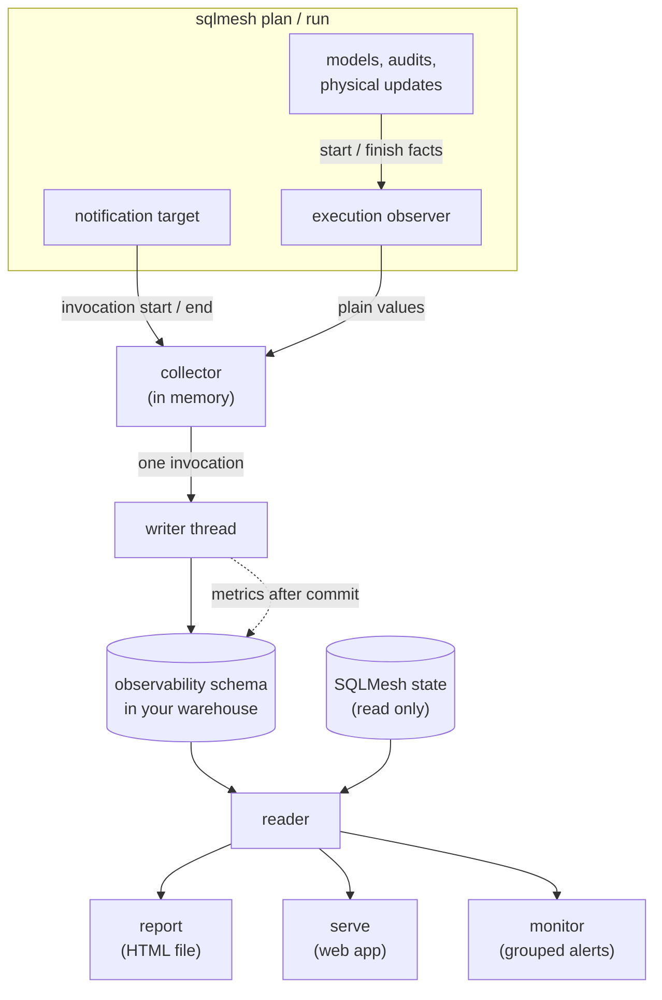

# How it works

The package has a **write path**, which runs inside SQLMesh, and a **read path**, which runs
afterwards and never touches SQLMesh's own tables.

## Write path

`install()` runs while SQLMesh loads `config.py`. It does two things:

- It wraps `get_execution_observer` on the current console object. SQLMesh's
  [execution-observation API](https://github.com/SQLMesh/sqlmesh/blob/main/docs/reference/execution_observations.md)
  calls the observer at the start and finish of each piece of work: plan stages, model batches,
  physical and virtual updates, audits, and queries. The observer copies plain values (model,
  version, interval, audit result) and returns at once. It never holds SQLMesh objects and never
  opens a warehouse connection.
- It adds a notification target that marks where each plan or run starts and ends, with its
  environment and plan id.

When a plan or run ends, its records go to a writer thread, which writes them to the package's own
tables. The `sqlmesh` command waits for that, at most 60 seconds, so a scheduled run is saved
before its process exits. Passive metrics (row counts, freshness, column metrics) are measured
after that commit, on the same thread. Nothing on this path can change the SQLMesh result:
errors are logged and ignored.

## Keyed by version, not environment

SQLMesh builds a model **version** once, often in a dev environment, and then promotes it to prod
by pointing prod's views at the same table (a virtual update). So every row is keyed by version
and physical table, and `environment` only records where the work ran.

"What is in prod" is decided when you read. The read path asks SQLMesh state which versions the
environment points at, and keeps rows for those versions. That has three effects:

- A version built and audited in dev, then promoted, shows in prod with its dev audit results.
- A dev-only version never shows in prod.
- The latest invocation that targeted prod is always included, so a prod plan stopped by a
  blocking audit still shows, even though nothing was promoted.

## Read path

`report`, `serve`, and `monitor` load `config.py` without creating a SQLMesh `Context`. They read
the log with plain SELECTs and SQLMesh state through its read-only state reader, for environments,
model owners, and column types. Anomalies in passive metrics are scored at this point, with the
same rule as the `volume_anomaly` audit. Changing a threshold therefore needs no backfill.

- [`report`](report.md) renders everything into one offline HTML file.
- [`serve`](report.md#web-app) renders the same page per request.
- [`monitor`](alerts.md) keeps only issues that are new since its last successful send, groups
  them by owner, and sends them through your notification target.

## What gates a deploy

Passive monitors never block anything. To stop a plan on an anomaly, attach the package's
[audits](audits.md). They are ordinary SQLMesh audits that recompute history from the model's
own table, so with `blocking := true` they stop a plan before promotion like any other audit.
